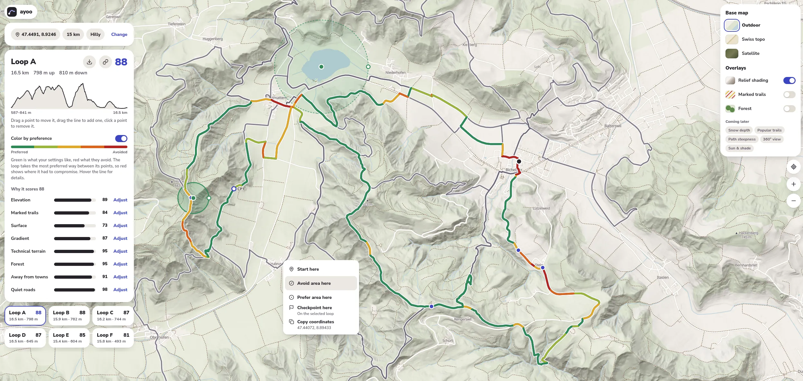

# ayoo

> [!NOTE]
> This project is very much in its prototyping stage: it's a place to test ideas.
> Expect features, data formats and behaviour to change without notice.

Generates trail-running loops in Switzerland based on multiple adjustable metrics.
Give it a start, a distance and what you care about; it returns a few distinct loops,
scored against your settings, that you can drag-edit, share as a link and download as GPX.



## What it routes by

Each metric is a cost term with an importance slider (Off … Normal … Above all). The
generator places turning points where your weighted costs are low and routes between them.

**Built**

- **Distance**: loops within ±10 % of the target.
- **Elevation**: a climb target (Gentle, Hilly, Mountain or meters) and how closely to match it, or as much as possible.
- **Gradient**: whether you like steep or gentle uphills and downhills.
- **Surface**: avoid asphalt and paved paths.
- **Technical terrain**: the hardest trail grade allowed (T1–T6), and whether to avoid or seek harder ones.
- **Marked trails**: prefer official Swiss hiking trails.
- **Forest**: prefer running through forest.
- **Away from towns**: avoid villages and built-up areas.
- **Quiet roads**: avoid busy road classes.
- **Avoid/prefer areas**: circles you place on the map (long-press or right-click) and resize.

Not a cost term, just a map layer: **Travel time** colours where one or more travel origins get
by public transport within their own time budgets (Saturday morning). It is dark where everyone
gets there and light where only some do.

**Planned**

- Views (viewshed), which will also pull loops toward peaks and viewpoints.
- Remoteness.
- Snow cover for a date.
- POIs: water, toilets, shops.
- Webcams and photos.
- Popular trails.

## Run it

Needs [mise](https://mise.jdx.dev) (pinned Rust, Node, just), plus `curl`, `jq` and `unzip`.

```sh
mise install && (cd web && npm ci)
just data demo      # OSM, swissALTI3D and Wanderwege into data/raw (`ch` for all of Switzerland, ~55 GB)
just import demo    # build data/graph.bin
just dev            # API on :8080, client on http://localhost:5173
```

Other commands:

- `just check` runs fmt, clippy, the tests and the typecheck.
- `just smoke` runs an end-to-end health, generate and route check.
- `just transit` fetches the Swiss GTFS feed and builds `data/transit.bin` for the Travel time layer.
- `docker compose up` runs the import and the server as one image.

Server settings: `BIND`, `DATA_DIR`, `STATIC_DIR`.

Data: © swisstopo, © OpenStreetMap contributors, timetable from opentransportdata.swiss.
