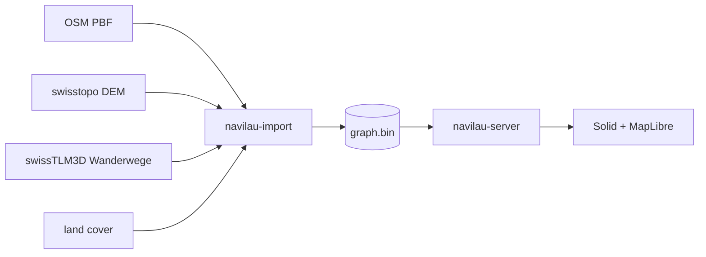

# Design — navilau

Status: **approved; engine and importer in implementation** (D29), 2026-11-18.
Generation, the generate API and the cache are not started.
Companions: `brief.md` (intent and backlog), `decisions.md` (log),
`routing-engines.md` (engine choice), `layers.md` (data sources and licenses).

Revision history:

- **v1** — first written draft.
- **v2** — after the builder review: generation targeting (length repair +
  refinement objective), geometry Z for elevation profiles, explicit `profile`
  struct, PMTiles out of v1, repetition penalty, non-deterministic share links,
  score formula. After owner answers: closest matches, reachability deferred
  (D19), soft climb and hilliness (D20). Base map made explicit (D21).
- **v3** — pre-implementation patch after plan review: `waypoints` in the route
  payload, official category replaces the id table, 150 m snap threshold,
  repetition penalty exempts the start stem, BLAKE3 cache key over a quantized
  request, edited-waypoint URL state, Rust 1.100.
- **v4** — second design review: forward A* with a profile-derived lower bound,
  route steps for mid-edge starts, edge splitting at elevation extrema,
  native-swiss-grid DEM, FlatGeobuf official trails, OSM land cover, midpoint
  drag handles, waypoints in the generate response, raster maxzoom.
- **v5** — pre-implementation review, 2026-11-18 (D29–D37): grade histogram
  instead of extrema splitting, CSR adjacency, highway class and tag
  inference, non-saturating score in per-meter units, `max_sac` 3,
  configurable DEM (swissALTI3D default, DHM25), no GDAL.

## 1. Intent

A personal web app that generates trail-running loop routes in Switzerland
from a few inputs and a set of preference weights, quickly enough to replace
the current six-tool planning workflow. Success looks like: open the site, set
start, distance and hilliness, get several genuinely different routes that
already respect trail existence, surface, technicality, nature and steepness,
drag one point to adjust it, export the GPX.

## 2. Goals

- Fast: warm request to routes in well under a second; cold generation in a
  few seconds.
- Trustworthy: official-trail share shown per route, weak-data segments
  penalized and visible.
- Quick path minimal, power controls available but collapsed.
- Layers are additive: adding viewshed, snow or POIs later must not reshape the
  core.
- One image, one compose file; runs locally and deploys to Kubernetes.

## 3. Non-goals (v1)

- Point-to-point, out-and-back, or multi-day routes. Loops only.
- Accounts, multi-user, database, billing.
- Travel-time reachability from home (deferred; any map point is a start).
- Live public-transport routing at request time.
- Mobile app, PWA/offline support, turn-by-turn navigation (D23).
- Coverage outside Switzerland, including cross-border loops.
- Viewshed, snow, sun/shade, POIs, webcams, photos, elevation-profile matching
  in the first usable version.

## 4. Anti-goals

- Suggesting a route on a trail that may not exist without flagging it.
- Filling a distance target by routing through the city.
- Opening into a wall of sliders.

## 5. Constraints

- Switzerland only; other regions are a later data problem, not an engine one.
  The graph is cut from the CH OSM extract, so a route cannot leave the
  country. A buffered extract for border cities is a later change, and the
  region-pack layout (§6.3) is the path to both.
- Licenses: swisstopo OGD (attribution, commercial allowed), SLF CC BY 4.0,
  OSM ODbL, GTFS from opentransportdata.swiss (registration).
- Client lightweight; no graph download.
- Rust for the engine and service; TypeScript + Solid + MapLibre for the UI.

## 6. Architecture



Overlay PMTiles are produced by the same importer when the layer milestone
lands; v1 has no tile endpoint.

### 6.1 Components

- `navilau-import` (binary): builds `graph.bin` from raw sources. Offline,
  idempotent, versioned by OSM date.
- `navilau-server` (binary, axum): mmaps `graph.bin`, serves the API and the
  static client.
- `web/`: Solid + MapLibre client, built to static assets and served by the
  server in production; Vite dev server proxies the API in development.

### 6.2 Repo layout

One Cargo crate with two binaries; `web/` next to it. Splitting into a
workspace is deferred until there is a reason.

```
Cargo.toml
src/
  lib.rs
  graph.rs        graph format, load, snap
  cost.rs         profile -> per-edge cost
  route.rs        A* and route assembly
  generate.rs     anchors, seeds, refinement, dedup
  region.rs       region packs and data providers
  server.rs       axum app
  bin/import.rs
  bin/server.rs
web/
data/             gitignored
Dockerfile
docker-compose.yml
justfile
mise.toml
```

### 6.3 Region packs (extensibility)

The engine, graph format, cost model, generator and API are region-agnostic.
Only the import adapters know about a country. An import is driven by a
`RegionPack`:

- boundary (bbox or polygon), OSM extract, DEM source;
- optional providers: official trails, land cover, settlements, snow, POIs.

Providers are traits (`OfficialTrails`, `LandCover`, ...). A missing provider
leaves its factor neutral and the UI hides the corresponding claim (outside
Switzerland: "official share unavailable"). Adding a country means writing its
providers and tag rules; nothing else changes. Packs may carry a buffer and are
merged at import, which is also the later path to cross-border loops.

## 7. Graph format

Single file, mmap'd, little-endian. The header carries magic, version, OSM
date and counts; section offsets are derived from one layout function shared by
the writer and the reader.

Sections are struct-of-arrays, each 8-byte aligned, read zero-copy.

| Section | Fields |
|---|---|
| Node | `f32 lat`, `f32 lon`, `i16 elev_m` |
| Adjacency (CSR) | `u32 node_first[n+1]`, `u32 adj[2m]` = `edge << 1 \| reversed` |
| Edge | `u32 from`, `u32 to`, `u32 length_cm`, `i16 gain_m`, `i16 loss_m`, `u8 grade[9]`, `u8 surface`, `u8 sac`, `u8 highway`, `u8 forest_pct`, `u8 urban`, `u8 official_category`, `u8 flags`, `u32 geom_start`, `u32 geom_len` |
| Geometry | `f32 lat`, `f32 lon` pairs, referenced by edges |
| Geometry Z | `i16 elev_m` per geometry vertex, parallel to Geometry |
| Anchors | `f32 lat`, `f32 lon`, `u8 kind`, `f32 weight` |
| Snap index (D50) | `u32 cell_first[cells+1]`, `u32 seg[k]` = global geometry index of a segment's first vertex |

Each edge is stored once. Reverse traversal swaps gain and loss and inverts the
slope sign; other attributes are symmetric. `official_category` is 0 for none
and 1–3 for the official network class (yellow/red/blue), so a marked Wanderweg
can be weighted differently from an alpine route. `flags` holds informal /
missing-tag / bridge / tunnel / ferry / surface-inferred. Gain and loss
accumulate with a 2 m vertical deadband to suppress DEM jitter and serve the
climb statistics only. Edges are split at junctions only.

`grade` is the slope histogram (D30): the share of the edge's length (sum 255)
in nine signed bands with symmetric edges, ≤ −25, −25…−20, −20…−15, −15…−8,
−8…8, 8…15, 15…20, 20…25, ≥ 25 %, for the forward direction. Reverse
traversal reads the array backwards. The DEM is sampled every ~10 m and the
grade measured over ~25 m windows. Bridges and tunnels interpolate elevation
between their endpoints instead of sampling the ground. `highway` is the OSM
highway class (D31).

The snap index is a fixed grid of 250 m cells in the local projection at the
bbox mid-latitude. `cells` follows from the header bbox, and `k` (header bytes
52..56) counts entries; a segment is listed in every cell its bbox touches. A
segment's edge is found by binary search over `geom_start`. The importer
builds it, so the server maps it like any other section and starts without
building a spatial index.

Storing Z per geometry vertex makes elevation profiles exact without shipping a
DEM to the runtime; it costs 2 bytes per vertex.

## 8. Cost model

Every edge gets `cost = length_m * product(factors)` for the direction of
travel. The same function serves routing, generation scoring and drag editing.

Proposed defaults (all exposed as sliders; these are starting points, tuned via
the drag debugger):

| Factor | Default |
|---|---|
| Slope | per grade band, length-weighted over the histogram: ≤ −25 %: 2.5; −25…−15: 1.8; −15…−8: 1.2; −8…8: 1.0; 8…20 up: 0.95; > 20 up: 1.0 |
| Surface | asphalt 2.0, paved 1.5, compacted 1.1, gravel 1.0, dirt 0.95, grass 1.1, rock 1.2, unknown 1.4 |
| Technicality | T1 1.0, T2 1.05, T3 1.15, T4 1.4 (excluded by default, `max_sac` 3, D35), missing tag on `path`/`bridleway` 1.3; other highway types default to T1 |
| Official trail | 0.7 |
| Forest | 0.9 |
| Urban | inside settlement 2.0, within 200 m 1.3 |
| Exclusion marker | multiply by 5, or block if the marker is set to block |

Missing surface tags are inferred from the highway type (D31): roads →
asphalt, tracks from `tracktype` (grade1 paved … grade5 grass, none → gravel),
paths and footways stay unknown. Inferred values carry a flag.

Hard filters, applied before costing: sac above the profile maximum, motorway
and trunk always, access restrictions, exclusion markers configured to block.

A weight `w ∈ [0, 4]` raises a factor to `factor^w` (D51): 0 disables the
term, 1 is the table value, 4 lets one term dominate. Powers stay positive, so
no setting produces a non-positive edge cost. The `slope` weight ("Counts" in
the Hills panel) scales the uphill and downhill factors together;
`uphill`/`downhill` run −1 gentle … 0 any … +1 steep and blend the band tables
(D53). `climb_pressure ∈ [0, 1]` is set by the generator, not the user: every
band steeper than 8 % (both directions) is multiplied by `1 − 0.8·pressure`, so
at full pressure hilly edges cost a fifth of their slope factor (D52).

Score = `100 * min(0.63 / mean_factor_default, 1)^(1/6)` (D32, geometric mean per D44), where
`mean_factor_default = cost / distance_m`, the cost per meter under **default
weights**, without exclusion or repetition penalties, so the score does not
move with the sliders. A flat official forest trail (0.63) scores 100, plain
gravel 63, asphalt about 32; only routes better than that clamp. The
per-term contribution is displayed as bars so the drag debugger shows *why* the
score moved.

Distance is **not** in the cost function; it is a target enforced by
generation. Climb enters only through the generator's climb pressure above;
it is a soft goal and never filters a route (D20, D52).

## 9. Generation

> **As built (D39, D52):** triangle (θ±30°) and 3-via (θ−40°, θ, θ+40°) seeds
> at 12 headings, pulled to an anchor within r/3. Per seed, up to 8 attempts
> rescale the radius by D*/D and bisect the climb pressure inside
> `[0, strictness]` until distance is within ±10 % and climb within ±15 % of the
> target. "As much as possible" uses `pressure = strictness`. Rank
> `= |D−D*|/D* + (0.25 + 4·strictness)·|C−C*|/C* − 0.2·score/100`; for max climb
> the climb term is `−(C/D)/0.1`. The steps below are the original design.

Seeds alone cannot hit a distance target; the local search does the targeting.

1. **Anchors.** Radius `R = clamp(target_distance / 3, 2 km, 12 km)`. Drop
   candidates inside `Block` exclusion zones, then rank the rest by interest
   (named OSM peak, lake, official panorama route, large forest block, DEM local
   maximum) and by relief gained from the start. Keep the top K, spread across
   headings.
2. **Seeds.** `start → A → B → start` for anchor pairs with enough angular
   separation. If no anchors exist, heading fallback: eight headings, three
   ring points at radius R.
3. **Legs with repetition penalty.** Route the legs in order with A*, carrying
   the set of edges already used; an edge used earlier costs ×5, except within
   500 m of the start, so an access stem or a peninsula trail can be shared.
   The penalty stops a seed collapsing into an out-and-back elsewhere. It makes
   cost path-dependent, so this search is greedy rather than provably optimal.
4. **Length repair.** If the seed is short, insert the next-ranked anchor
   between the existing via points and reroute; repeat up to three times. If it
   is too long, drop the weakest anchor.
5. **Refine.** Local search over via points. Objective
   `J = |D−D*|/D* + 0.25·|C−C*|/C* − 0.2·score/100`, where the climb term only
   applies when a climb target is given. Moves: shift a via point radially or
   perpendicular by 100 m, 300 m, 1 km; insert or remove a via point; reroute
   the affected legs. Accept moves that lower J. Two rounds. Distance
   dominates; climb is a nudge, not a requirement.
6. **Filter and dedup.** Keep routes within ±10 % distance. Climb never
   filters. Overlap = shared edge distance / shorter route distance; above 0.5
   keep the stronger route.
7. **Return** up to 6 routes, sorted by distance error. If none is in band,
   return the closest candidates with `distance_met: false` rather than an
   empty list.

`Route` is a list of steps `{edge, from_t, to_t}`. A route can start and end
mid-edge; geometry, distance and climb are sliced from those fractions, so two
waypoints on the same edge connect directly instead of running to the endpoint
and back.

Legs run in parallel with `rayon`; results are cached by canonical request plus
graph version.

## 10. API

Same origin as the client; no auth, no CORS.

`profile` is an explicit value, not a server-side preset. Quick-mode presets are
expanded on the client, so the server only ever sees one shape. Each weight is
validated to `0..=3`; anything outside is a `422`.

```json
{
  "weights": { "slope": 1.0, "surface": 1.0, "tech": 1.0,
               "official": 1.0, "forest": 1.0, "urban": 1.0 },
  "max_sac": 3,
  "exclude": [ { "lat": 47.0, "lon": 8.0, "radius_m": 5000,
                 "mode": "penalize" } ]
}
```

| Endpoint | Body / query | Returns |
|---|---|---|
| `POST /api/generate` | `{start, distance_m, climb?: {target_m: number \| null, strictness: 0–1}, profile, count}` | `{routes: [...]}` |
| `POST /api/route` | `{waypoints, profile}` | `{route}` |
| `GET /api/health` | | `{status, graph_date}` |
| `GET /` | | static client |

`route` = `{geometry: GeoJSON LineString with [lon, lat, z], waypoints:
[{lat, lon}], distance_m, climb_m, descent_m, score, breakdown,
official_share, distance_met, graph_date, climb_pressure, cost_per_m}`.
`climb_pressure` is what the route was generated with; the client sends it back
in `profile.weights` when re-routing an edit. `cost_per_m` has one value per
coordinate (the step leaving it) for the color-by-cost view (D54). `waypoints` are the via points the
route was built from, so the client can place drag handles; `generate` returns
them with every route.

`POST /api/route` never applies the repetition penalty: a manual drag may
legitimately produce an out-and-back. It requires 2–20 waypoints and snaps
within 150 m, else `422`.

Caching: in-memory LRU keyed by the 32-byte BLAKE3 digest of a quantized
request (lat/lon to 1e-6, distances to 1 m) plus the graph version;
`Cache-Control: no-store` on `generate` in v1, with `X-Cache` only as a debug
header. A share link reproduces the query, not the exact response: parallel
legs and tie-breaking are not deterministic across runs, and that is accepted.

## 11. Frontend

- Left panel: start (last used, or click the map), distance, "How hilly?"
  (Gentle/Hilly/Mountain/Max quick picks over a meter slider and a "Stick to
  it" strictness slider, D52/D56), one button. Weight sliders live in each
  score bar's Adjust panel (D56); changes regenerate live (D55).
- Presets follow the distance (30/60/90 m per km); a slider value is fixed
  meters; Max asks for as much climb as possible.
- The selected loop is drag-editable with Undo/Reset and an optional
  color-by-cost view (D54).
- Base map: swisstopo WMTS fetched directly by the browser from
  `wmts.geo.admin.ch` (CORS `*`, CDN-cached, `©swisstopo` attribution):
  `pixelkarte-farbe` (JPEG, maxzoom 18) by default, `swissimage` satellite
  (JPEG, maxzoom 20) as a toggle for checking whether a trail exists, plus
  `ch.swisstopo.swisssurface3d-reliefschattierung-monodirektional` (PNG,
  maxzoom 18; check its WMTS matrix path, since some `swisssurface3d` layers
  need a timestamp instead of `current`). Set `maxzoom` on each raster source
  so MapLibre overzooms instead of requesting 404 tiles. The server does not
  proxy these tiles.
- Overlay tiles (official trails, forest, viewshed, ...) are ours: produced by
  the importer as PMTiles and served by `navilau-server` when those layers land.
- Map: MapLibre. Candidate routes drawn from the list; selected route
  emphasized.
- Results: scrollable cards with distance, climb, score, official share.
  Clicking a card highlights the route and shows the elevation profile (read
  from the geometry Z values; reverse the sliced coordinates when `from_t >
  to_t`) and score breakdown. Out-of-band results are labeled "closest match".
- Drag editing: edit mode reveals handles at the interior waypoints; dragging
  shows a ghost line, and releasing calls `POST /api/route` with the new
  waypoints. Dragging a segment midpoint inserts a new waypoint there, so a
  15 km loop can be shaped with more than two anchors. Live stats and score
  replace the card values.
- Export: GPX download from the selected route.
- State: Solid signals. Last start and profile in localStorage. The query is
  encoded in the URL; after a drag edit the edited waypoints are stored too
  (`?w=lat,lon;lat,lon;...&p=<profile>`). Opening a link with `w` calls
  `POST /api/route` with those waypoints and that profile, not `generate`, so
  the edit is reproduced. No router library.
- No SSR.

## 12. Local setup and deployment

- `mise` pins Rust, Node, just.
- `just dev` runs the server and Vite with a proxy; requires `data/graph.bin`.
- `just data` fetches the sources: the Geofabrik CH PBF, swissALTI3D 2 m
  tiles for the region bbox (STAC API) or DHM25, and the swissTLM3D Wanderwege
  GPKG. Only curl, jq and unzip; no GDAL (D37).
- `just import REGION=ch` builds the full graph; `REGION=demo` builds the
  Wattwil–Ziegelbrücke bbox (D34). The DEM source is configurable (D33).
- `docker compose up` is the full-stack path: an `import` service that exits
  immediately if `data/graph.bin` exists (otherwise builds `REGION`, default
  `demo`) and a `server` service that depends on its successful completion.
- `Dockerfile` (D64): multi-stage. `node:26.13.1-slim` builds the client
  (glibc, because the Solid compiler ships per-libc native binaries),
  `rust:1.100.0-alpine` builds static musl binaries, and the final stage is
  `distroless/static-debian12:nonroot` with `navilau-server`,
  `navilau-import`, the client at `/app/web` and `/data` as a volume. The graph
  is mounted, not baked in. Port 8080, non-root, ~14 MB. The server stops
  gracefully on SIGTERM.
- No Kubernetes manifests.

## 13. Testing

- Unit: grade histogram direction, cost monotonicity (steeper descent costs
  more), surface/tech lookup, dedup, GPX serialization.
- Import fixture: a hand-written tiny `.osm` XML and a synthetic DEM in
  `tests/fixtures`, so the pipeline runs in CI without downloads.
- Generation: fixture graph with a known loop; assert the target-miss path
  returns `distance_met: false` rather than nothing, and that a reachable
  target is hit within the band.
- Golden route: fixed fixture graph, fixed request, assert distance band and
  that the route uses the expected edges.
- API: axum `oneshot` tests for endpoints and error codes.
- Frontend: manual in the browser for v1; no test suite until the UI stabilizes.
- `just check`: fmt, clippy, tests.

## 14. Risks

- A* latency on a 4M-node graph. Mitigation: rayon, request cache, and a CH
  path for the default profile only if measured latency demands it.
- OSM trail quality in remote areas. Mitigation: official share and penalties
  make it visible rather than hidden.
- Feature-anchor ranking is subjective; weak anchors produce boring loops.
- Horizon-profile precompute (viewshed/sun) may be heavier than estimated.
- Cross-border loops are impossible in v1.
- The base map depends on geo.admin.ch availability and its fair-use limits.
  Fine for a personal deployment; a public launch needs a checked quota or a
  self-hosted style.
- Target misses are a normal outcome near small villages or flat areas; the UI
  must show closest matches honestly instead of hiding them.

## 15. Open items left to the builder

- Tune the factor defaults with the drag debugger.
- Anchor ranking function and K.
- Cache eviction and TTL.
- GPX metadata and waypoint naming.
- Region pack trait boundaries and the provider registry.

## 16. Milestones

See `docs/milestones.md`.
