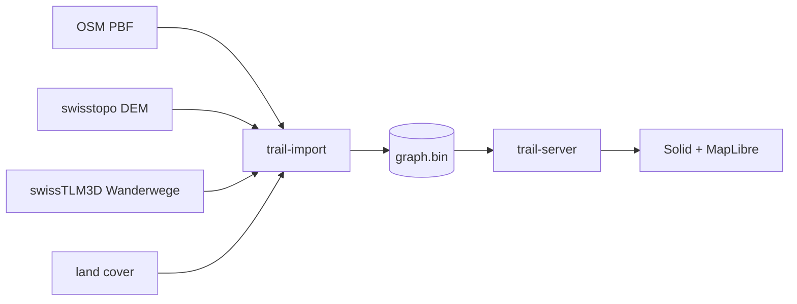

# Design — trail-route

Status: **approved in principle; implementation paused**, 2026-11-16. The
project is still in design iteration. The plan in `docs/milestones.md` is
written but not being executed.
Companions: `brief.md` (intent and backlog), `decisions.md` (log),
`routing-engines.md` (engine choice), `layers.md` (data sources and licences).

Revision history:

- **v1** — first written draft.
- **v2** — after the builder review: generation targeting (length repair +
  refinement objective), geometry Z for elevation profiles, explicit `profile`
  struct, PMTiles out of v1, repetition penalty, non-deterministic share links,
  score formula. After owner answers: closest matches, reachability deferred
  (D19), soft climb and hilliness (D20). Base map made explicit (D21).
- **v3** — pre-implementation patch after plan review: `waypoints` in the route
  payload, official category replaces the id table, 150 m snap threshold,
  repetition penalty exempts the start stem, BLAKE3 cache key over a quantized
  request, edited-waypoint URL state, Rust 1.100.
- **v4** — second design review: forward A* with a profile-derived lower bound,
  route steps for mid-edge starts, edge splitting at elevation extrema,
  native-swiss-grid DEM, FlatGeobuf official trails, OSM land cover, midpoint
  drag handles, waypoints in the generate response, raster maxzoom.

## 1. Intent

A personal web app that generates trail-running loop routes in Switzerland
from a few inputs and a set of preference weights, quickly enough to replace
the current six-tool planning workflow. Success looks like: open the site, set
start, distance and hilliness, get several genuinely different routes that
already respect trail existence, surface, technicality, nature and steepness,
drag one point to adjust it, export the GPX.

## 2. Goals

- Fast: warm request to routes in well under a second; cold generation in a
  few seconds.
- Trustworthy: official-trail share shown per route, weak-data segments
  penalised and visible.
- Quick path minimal, power controls available but collapsed.
- Layers are additive: adding viewshed, snow or POIs later must not reshape the
  core.
- One image, one compose file; runs locally and deploys to Kubernetes.

## 3. Non-goals (v1)

- Point-to-point, out-and-back, or multi-day routes. Loops only.
- Accounts, multi-user, database, billing.
- Travel-time reachability from home (deferred; any map point is a start).
- Live public-transport routing at request time.
- Mobile app, PWA/offline support, turn-by-turn navigation (D23).
- Coverage outside Switzerland, including cross-border loops.
- Viewshed, snow, sun/shade, POIs, webcams, photos, elevation-profile matching
  in the first usable version.

## 4. Anti-goals

- Suggesting a route on a trail that may not exist without flagging it.
- Filling a distance target by routing through the city.
- Opening into a wall of sliders.

## 5. Constraints

- Switzerland only; other regions are a later data problem, not an engine one.
  The graph is cut from the CH OSM extract, so a route cannot leave the
  country. A buffered extract for border cities is a later change, and the
  region-pack layout (§6.3) is the path to both.
- Licences: swisstopo OGD (attribution, commercial allowed), SLF CC BY 4.0,
  OSM ODbL, GTFS from opentransportdata.swiss (registration).
- Client lightweight; no graph download.
- Rust for the engine and service; TypeScript + Solid + MapLibre for the UI.

## 6. Architecture



Overlay PMTiles are produced by the same importer when the layer milestone
lands; v1 has no tile endpoint.

### 6.1 Components

- `trail-import` (binary): builds `graph.bin` from raw sources. Offline,
  idempotent, versioned by OSM date.
- `trail-server` (binary, axum): mmaps `graph.bin`, serves the API and the
  static client.
- `web/`: Solid + MapLibre client, built to static assets and served by the
  server in production; Vite dev server proxies the API in development.

### 6.2 Repo layout

One Cargo crate with two binaries; `web/` next to it. Splitting into a
workspace is deferred until there is a reason.

```
Cargo.toml
src/
  lib.rs
  graph.rs        graph format, load, snap
  cost.rs         profile -> per-edge cost
  route.rs        A* and route assembly
  generate.rs     anchors, seeds, refinement, dedup
  region.rs       region packs and data providers
  server.rs       axum app
  bin/import.rs
  bin/server.rs
web/
data/             gitignored
Dockerfile
docker-compose.yml
justfile
mise.toml
```

### 6.3 Region packs (extensibility)

The engine, graph format, cost model, generator and API are region-agnostic.
Only the import adapters know about a country. An import is driven by a
`RegionPack`:

- boundary (bbox or polygon), OSM extract, DEM source;
- optional providers: official trails, land cover, settlements, snow, POIs.

Providers are traits (`OfficialTrails`, `LandCover`, ...). A missing provider
leaves its factor neutral and the UI hides the corresponding claim (outside
Switzerland: "official share unavailable"). Adding a country means writing its
providers and tag rules; nothing else changes. Packs may carry a buffer and are
merged at import, which is also the later path to cross-border loops.

## 7. Graph format

Single file, mmap'd, little-endian. The header carries magic, version, OSM
date and counts; section offsets are derived from one layout function shared by
the writer and the reader.

| Section | Fields |
|---|---|
| Node | `f32 lat`, `f32 lon`, `i16 elev_m` |
| Edge | `u32 from`, `u32 to`, `u32 length_cm`, `i16 gain_m`, `i16 loss_m`, `u8 surface`, `u8 sac`, `u8 forest_pct`, `u8 urban`, `u8 official_category`, `u8 flags`, `u32 geom_start`, `u32 geom_len` |
| Geometry | `f32 lat`, `f32 lon` pairs, referenced by edges |
| Geometry Z | `i16 elev_m` per geometry vertex, parallel to Geometry |

Each edge is stored once. Reverse traversal swaps gain and loss and inverts the
slope sign; other attributes are symmetric. `official_category` is 0 for none
and 1–3 for the official network class (yellow/red/blue), so a marked Wanderweg
can be weighted differently from an alpine route. `flags` holds informal /
missing-tag / bridge / tunnel / ferry. Gain and loss accumulate with a 2 m
vertical deadband to suppress DEM jitter. Edges are split at junctions and at
local elevation extrema, so `loss/len` describes one descent instead of
averaging a climb-and-descend way.

Storing Z per geometry vertex makes elevation profiles exact without shipping a
DEM to the runtime; it costs 2 bytes per vertex.

## 8. Cost model

Every edge gets `cost = length_m * product(factors)` for the direction of
travel. The same function serves routing, generation scoring and drag editing.

Proposed defaults (all exposed as sliders; these are starting points, tuned via
the drag debugger):

| Factor | Default |
|---|---|
| Slope | grade ≤ −25 %: 2.5; −25…−15: 1.8; −15…−8: 1.2; −8…8: 1.0; 8…20 up: 0.95; > 20 up: 1.0 |
| Surface | asphalt 2.0, paved 1.5, compacted 1.1, gravel 1.0, dirt 0.95, grass 1.1, rock 1.2, unknown 1.4 |
| Technicality | T1 1.0, T2 1.05, T3 1.15, T4 1.4, T5+ excluded by default, missing tag 1.3 |
| Official trail | 0.7 |
| Forest | 0.9 |
| Urban | inside settlement 2.0, within 200 m 1.3 |
| Exclusion marker | multiply by 5, or block if the marker is set to block |

Hard filters, applied before costing: sac above the profile maximum, motorway
and trunk always, access restrictions, exclusion markers configured to block.

A slider weight `w` adjusts a factor as `1 + (factor − 1) * w`, so 0 disables
the term and 2 doubles its deviation from neutral. The result is clamped to a
floor of 0.05, so no slider setting can produce a non-positive edge cost. The
`slope` weight is labelled "slope sensitivity" in the UI: it scales the uphill
bonus and the downhill penalty together.

Score = `100 * clamp(0.75 / cost_per_km, 0, 1)`, where
`cost_per_km = total_cost / (distance_m / 1000)`. 0.75 is the cost per km of a
flat, plain rural gravel trail; an ideal official forest trail (0.63) clamps at
100, a plain gravel route scores 75, asphalt-heavy routes land near 37. The
per-term contribution is displayed as bars so the drag debugger shows *why* the
score moved.

Distance and climb are **not** in the cost function. Distance is a target
enforced by generation and refinement; climb is soft and optional.

## 9. Generation

Seeds alone cannot hit a distance target; the local search does the targeting.

1. **Anchors.** Radius `R = clamp(target_distance / 3, 2 km, 12 km)`. Drop
   candidates inside `Block` exclusion zones, then rank the rest by interest
   (named OSM peak, lake, official panorama route, large forest block, DEM local
   maximum) and by relief gained from the start. Keep the top K, spread across
   headings.
2. **Seeds.** `start → A → B → start` for anchor pairs with enough angular
   separation. If no anchors exist, heading fallback: eight headings, three
   ring points at radius R.
3. **Legs with repetition penalty.** Route the legs in order with A*, carrying
   the set of edges already used; an edge used earlier costs ×5, except within
   500 m of the start, so an access stem or a peninsula trail can be shared.
   The penalty stops a seed collapsing into an out-and-back elsewhere. It makes
   cost path-dependent, so this search is greedy rather than provably optimal.
4. **Length repair.** If the seed is short, insert the next-ranked anchor
   between the existing via points and reroute; repeat up to three times. If it
   is too long, drop the weakest anchor.
5. **Refine.** Local search over via points. Objective
   `J = |D−D*|/D* + 0.25·|C−C*|/C* − 0.2·score/100`, where the climb term only
   applies when a climb target is given. Moves: shift a via point radially or
   perpendicular by 100 m, 300 m, 1 km; insert or remove a via point; reroute
   the affected legs. Accept moves that lower J. Two rounds. Distance
   dominates; climb is a nudge, not a requirement.
6. **Filter and dedup.** Keep routes within ±10 % distance. Climb never
   filters. Overlap = shared edge distance / shorter route distance; above 0.5
   keep the stronger route.
7. **Return** up to 6 routes, sorted by distance error. If none is in band,
   return the closest candidates with `distance_met: false` rather than an
   empty list.

`Route` is a list of steps `{edge, from_t, to_t}`. A route can start and end
mid-edge; geometry, distance and climb are sliced from those fractions, so two
waypoints on the same edge connect directly instead of running to the endpoint
and back.

Legs run in parallel with `rayon`; results are cached by canonical request plus
graph version.

## 10. API

Same origin as the client; no auth, no CORS.

`profile` is an explicit value, not a server-side preset. Quick-mode presets are
expanded on the client, so the server only ever sees one shape. Each weight is
validated to `0..=3`; anything outside is a `422`.

```json
{
  "weights": { "slope": 1.0, "surface": 1.0, "tech": 1.0,
               "official": 1.0, "forest": 1.0, "urban": 1.0 },
  "max_sac": 3,
  "exclude": [ { "lat": 47.0, "lon": 8.0, "radius_m": 5000,
                 "mode": "penalize" } ]
}
```

| Endpoint | Body / query | Returns |
|---|---|---|
| `POST /api/generate` | `{start, distance_m, climb_m?, profile, count}` | `{routes: [...]}` |
| `POST /api/route` | `{waypoints, profile}` | `{route}` |
| `GET /api/health` | | `{status, graph_date}` |
| `GET /` | | static client |

`route` = `{geometry: GeoJSON LineString with [lon, lat, z], waypoints:
[{lat, lon}], distance_m, climb_m, descent_m, score, breakdown,
official_share, distance_met, graph_date}`. `waypoints` are the via points the
route was built from, so the client can place drag handles; `generate` returns
them with every route.

`POST /api/route` never applies the repetition penalty: a manual drag may
legitimately produce an out-and-back. It requires 2–20 waypoints and snaps
within 150 m, else `422`.

Caching: in-memory LRU keyed by the 32-byte BLAKE3 digest of a quantized
request (lat/lon to 1e-6, distances to 1 m) plus the graph version;
`Cache-Control: no-store` on `generate` in v1, with `X-Cache` only as a debug
header. A share link reproduces the query, not the exact response: parallel
legs and tie-breaking are not deterministic across runs, and that is accepted.

## 11. Frontend

- Left panel: start (last used, or click the map), distance, hilliness slider
  (m/km, default 60), one button. Advanced drawer with the weight sliders, max
  sac, exclusion markers.
- Hilliness maps to an optional soft `climb_m` target (`hilliness × distance`).
  It biases the search; it never rejects a route.
- Base map: swisstopo WMTS fetched directly by the browser from
  `wmts.geo.admin.ch` (CORS `*`, CDN-cached, `©swisstopo` attribution):
  `pixelkarte-farbe` (JPEG, maxzoom 18) by default, `swissimage` satellite
  (JPEG, maxzoom 20) as a toggle for checking whether a trail exists, plus
  `ch.swisstopo.swisssurface3d-reliefschattierung-monodirektional` (PNG,
  maxzoom 18; check its WMTS matrix path, since some `swisssurface3d` layers
  need a timestamp instead of `current`). Set `maxzoom` on each raster source
  so MapLibre overzooms instead of requesting 404 tiles. The server does not
  proxy these tiles.
- Overlay tiles (official trails, forest, viewshed, ...) are ours: produced by
  the importer as PMTiles and served by `trail-server` when those layers land.
- Map: MapLibre. Candidate routes drawn from the list; selected route
  emphasised.
- Results: scrollable cards with distance, climb, score, official share.
  Clicking a card highlights the route and shows the elevation profile (read
  from the geometry Z values; reverse the sliced coordinates when `from_t >
  to_t`) and score breakdown. Out-of-band results are labelled "closest match".
- Drag editing: edit mode reveals handles at the interior waypoints; dragging
  shows a ghost line, and releasing calls `POST /api/route` with the new
  waypoints. Dragging a segment midpoint inserts a new waypoint there, so a
  15 km loop can be shaped with more than two anchors. Live stats and score
  replace the card values.
- Export: GPX download from the selected route.
- State: Solid signals. Last start and profile in localStorage. The query is
  encoded in the URL; after a drag edit the edited waypoints are stored too
  (`?w=lat,lon;lat,lon;...&p=<profile>`). Opening a link with `w` calls
  `POST /api/route` with those waypoints and that profile, not `generate`, so
  the edit is reproduced. No router library.
- No SSR.

## 12. Local setup and deployment

- `mise` pins Rust, Node, just.
- `just dev` runs the server and Vite with a proxy; requires `data/graph.bin`.
- `just import REGION=ch` builds the full graph; `REGION=demo` builds a small
  bbox for iteration.
- `docker compose up` is the full-stack path: an `import` service that exits
  immediately if `data/graph.bin` exists (otherwise builds `REGION`, default
  `demo`) and a `server` service that depends on its successful completion.
- `Dockerfile`: multi-stage — Node builds the client, Rust 1.100 (matching
  `mise.toml`) builds a static musl binary, final stage is distroless/static
  with the binary, `web/dist`, and `/data` as a volume. Port 8080. Runs as
  non-root.
- No Kubernetes manifests.

## 13. Testing

- Unit: slope histogram direction, cost monotonicity (steeper descent costs
  more), surface/tech lookup, dedup, GPX serialisation.
- Import fixture: a hand-written tiny `.osm` XML and a synthetic DEM in
  `tests/fixtures`, so the pipeline runs in CI without downloads.
- Generation: fixture graph with a known loop; assert the target-miss path
  returns `distance_met: false` rather than nothing, and that a reachable
  target is hit within the band.
- Golden route: fixed fixture graph, fixed request, assert distance band and
  that the route uses the expected edges.
- API: axum `oneshot` tests for endpoints and error codes.
- Frontend: manual in the browser for v1; no test suite until the UI stabilises.
- `just check`: fmt, clippy, tests.

## 14. Risks

- A* latency on a 4M-node graph. Mitigation: rayon, request cache, and a CH
  path for the default profile only if measured latency demands it.
- OSM trail quality in remote areas. Mitigation: official share and penalties
  make it visible rather than hidden.
- Feature-anchor ranking is subjective; weak anchors produce boring loops.
- Horizon-profile precompute (viewshed/sun) may be heavier than estimated.
- Cross-border loops are impossible in v1.
- The base map depends on geo.admin.ch availability and its fair-use limits.
  Fine for a personal deployment; a public launch needs a checked quota or a
  self-hosted style.
- Target misses are a normal outcome near small villages or flat areas; the UI
  must show closest matches honestly instead of hiding them.

## 15. Open items left to the builder

- Tune the factor defaults with the drag debugger.
- Anchor ranking function and K.
- Cache eviction and TTL.
- GPX metadata and waypoint naming.
- Region pack trait boundaries and the provider registry.

## 16. Milestones

See `docs/milestones.md`.
