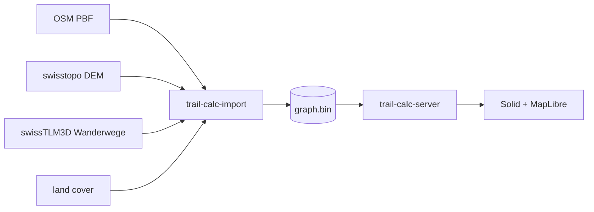

# Design — ayoo

Status: **v1 built**, 2026-11-20. Where this text and `decisions.md` differ, the
decisions win. Companions: `brief.md` (intent, backlog, open questions),
`decisions.md` (log), `layers.md` (data sources and licenses).

## 1. Intent

A personal web app that generates trail-running loop routes in Switzerland
from a few inputs and a set of preference weights, quickly enough to replace
the current six-tool planning workflow. Success looks like: open the site, set
start, distance and hilliness, get several genuinely different routes that
already respect trail existence, surface, technicality, nature and steepness,
drag one point to adjust it, export the GPX.

## 2. Goals

- Fast: warm request to routes in well under a second; cold generation in a
  few seconds.
- Trustworthy: official-trail share shown per route, weak-data segments
  penalized and visible.
- Quick path minimal, power controls available but collapsed.
- Layers are additive: adding a layer later must not reshape the
  core.
- One image, one compose file; runs locally and deploys to Kubernetes.

## 3. Non-goals (v1)

- Point-to-point, out-and-back, or multi-day routes. Loops only.
- Accounts, multi-user, database, billing.
- Live (real-time) public transport. The Travel time layer (ADR 0002) uses a
  static Saturday timetable and never affects routing.
- Mobile app, PWA/offline support, turn-by-turn navigation (D23).
- Coverage outside Switzerland, including cross-border loops.
- Viewshed, POIs, webcams, photos, elevation-profile matching
  in the first usable version.

## 4. Anti-goals

- Suggesting a route on a trail that may not exist without flagging it.
- Filling a distance target by routing through the city.
- Opening into a wall of sliders.

## 5. Constraints

- Switzerland only; other regions are a later data problem, not an engine one.
  The graph is cut from the CH OSM extract, so a route cannot leave the
  country. A buffered extract for border cities is a later change, and the
  region-pack layout (§6.3) is the path to both.
- Licenses: swisstopo OGD (attribution, commercial allowed), SLF CC BY 4.0,
  OSM ODbL, GTFS from opentransportdata.swiss (registration).
- Client lightweight; no graph download.
- Rust for the engine and service; TypeScript + Solid + MapLibre for the UI.

## 6. Architecture



Overlay PMTiles are produced by the same importer when the layer milestone
lands; v1 has no tile endpoint.

### 6.1 Components

- `trail-calc-import` (binary): builds `graph.bin` from raw sources. Offline,
  idempotent, versioned by OSM date.
- `trail-calc-server` (binary, axum): mmaps `graph.bin`, serves the API and the
  static client.
- `web/`: Solid + MapLibre client, built to static assets and served by the
  server in production; Vite dev server proxies the API in development.

### 6.2 Repo layout

One Cargo crate with two binaries; `web/` next to it. Splitting into a
workspace is deferred until there is a reason.

```
Cargo.toml
src/
  lib.rs
  graph.rs        graph format, load, snap
  cost.rs         profile -> per-edge cost
  route.rs        A* and route assembly
  generate.rs     seeds, via placement, radius and climb tuning, dedup
  region.rs       region packs and data providers
  server.rs       axum app
  bin/import.rs
  bin/server.rs
web/
data/             gitignored
Dockerfile
docker-compose.yml
justfile
mise.toml
```

### 6.3 Region packs (extensibility)

The engine, graph format, cost model, generator and API are region-agnostic.
Only the import adapters know about a country. An import is driven by a
`RegionPack`:

- boundary (bbox or polygon), OSM extract, DEM source;
- optional providers: official trails, land cover, settlements, POIs.

Providers are traits (`OfficialTrails`, `LandCover`, ...). A missing provider
leaves its factor neutral and the UI hides the corresponding claim (outside
Switzerland: "official share unavailable"). Adding a country means writing its
providers and tag rules; nothing else changes. Packs may carry a buffer and are
merged at import, which is also the later path to cross-border loops.

## 7. Graph format

Single file, mmap'd, little-endian. The header carries magic, version, OSM
date and counts; section offsets are derived from one layout function shared by
the writer and the reader.

Sections are struct-of-arrays, each 8-byte aligned, read zero-copy.

| Section | Fields |
|---|---|
| Node | `f32 lat`, `f32 lon`, `i16 elev_m` |
| Adjacency (CSR) | `u32 node_first[n+1]`, `u32 adj[2m]` = `edge << 1 \| reversed` |
| Edge | `u32 from`, `u32 to`, `u32 length_cm`, `i16 gain_m`, `i16 loss_m`, `u8 grade[9]`, `u8 surface`, `u8 sac`, `u8 highway`, `u8 forest_pct`, `u8 urban`, `u8 official_category`, `u8 flags`, `u32 geom_start`, `u32 geom_len` |
| Geometry | `f32 lat`, `f32 lon` pairs, referenced by edges |
| Geometry Z | `i16 elev_m` per geometry vertex, parallel to Geometry |
| Anchors | `f32 lat`, `f32 lon`, `u8 kind`, `f32 weight` |
| Snap index (D50) | `u32 cell_first[cells+1]`, `u32 seg[k]` = global geometry index of a segment's first vertex |

Each edge is stored once. Reverse traversal swaps gain and loss and inverts the
slope sign; other attributes are symmetric. `official_category` is 0 for none
and 1–3 for the official network class (yellow/red/blue), so a marked Wanderweg
can be weighted differently from an alpine route. `flags` holds informal /
missing-tag / bridge / tunnel / ferry / surface-inferred. Gain and loss
accumulate with a 2 m vertical deadband to suppress DEM jitter and serve the
climb statistics only. Edges are split at junctions only.

`grade` is the slope histogram (D30): the share of the edge's length (sum 255)
in nine signed bands with symmetric edges, ≤ −25, −25…−20, −20…−15, −15…−8,
−8…8, 8…15, 15…20, 20…25, ≥ 25 %, for the forward direction. Reverse
traversal reads the array backwards. The DEM is sampled every ~10 m and the
grade measured over ~25 m windows. Bridges and tunnels interpolate elevation
between their endpoints instead of sampling the ground. `highway` is the OSM
highway class (D31).

The snap index is a fixed grid of 250 m cells in the local projection at the
bbox mid-latitude. `cells` follows from the header bbox, and `k` (header bytes
52..56) counts entries; a segment is listed in every cell its bbox touches. A
segment's edge is found by binary search over `geom_start`. The importer
builds it, so the server maps it like any other section and starts without
building a spatial index.

Storing Z per geometry vertex makes elevation profiles exact without shipping a
DEM to the runtime; it costs 2 bytes per vertex.

## 8. Cost model

Every edge gets `cost = length_m * product(factors)` for the direction of
travel. The same function serves routing, generation scoring and drag editing.

Defaults (each term is one typed multiplier in the settings table, D106; these
are starting points, tuned via the drag debugger):

| Factor | Default |
|---|---|
| Slope | per grade band, length-weighted over the histogram: ≤ −25 %: 2.5; −25…−15: 1.8; −15…−8: 1.2; −8…8: 1.0; 8…20 up: 0.95; > 20 up: 1.0 |
| Surface | asphalt 2.0, paved 1.5, compacted 1.1, gravel 1.0, dirt 0.95, grass 1.1, rock 1.2, unknown 1.4 |
| Technicality | T1 1.0, T2 1.05, T3 1.15, T4 1.4 (excluded by default, `max_sac` 3, D35), missing tag on `path`/`bridleway` 1.3; other highway types default to T1 |
| Official trail | 0.7 |
| Forest | 0.9 |
| Urban | inside settlement 2.0, within 200 m 1.3 |
| Quiet roads | unclassified/residential 1.1, tertiary 1.3, secondary 1.6, primary 2.0, everything else 1.0 (D93) |
| Exclusion marker | soft avoid ×`avoid_factor` (default 5), soft prefer ×`prefer_factor` (default 0.5), or block (D109) |
| Repeat | edges the loop already used ×`repeat` (default 5, 0.01–1000, D109) |

Missing surface tags are inferred from the highway type (D31): roads →
asphalt, tracks from `tracktype` (grade1 paved … grade5 grass, none → gravel),
paths and footways stay unknown. Inferred values carry a flag.

Hard filters, applied before costing: sac above the profile maximum, motorway
and trunk always, access restrictions, exclusion markers configured to block.

A weight `w` raises a factor to `factor^w` (D51, D106): 0 disables the term, 1
is the table value. Surface, official, forest, urban, traffic and view take
`w ∈ [−100, 100]`, so a negative weight flips avoid into prefer; slope and tech
take `[0, 100]` (their direction comes from `uphill`/`downhill`/`technical`).
The client shows each weight as the multiplier it gives the term's key class
(asphalt 2.0, marked 0.7, full forest 0.9, town 2.0, busy road 2.0, wide view
0.7, steepest band 2.5, T4+ 1.4), clamped to ×0.001–×1000. The A* bound is the
product of each term's smallest weighted factor, times `min(1, repeat)` and
`prefer_factor` when a prefer area exists, so it stays admissible for negative
weights and a repeat penalty below 1. Powers stay positive, so
no setting produces a non-positive edge cost. The `slope` weight ("Counts" in
the Hills panel) scales the uphill and downhill factors together;
`uphill`/`downhill` run −1 gentle … 0 any … +1 steep and blend the band tables
(D53). `climb_pressure ∈ [0, 1]` is set by the generator, not the user: every
band steeper than 8 % (both directions) is multiplied by `1 − 0.8·pressure`, so
at full pressure hilly edges cost a fifth of their slope factor (D52).

Score (D84): `100 · preference^(1/7)`, or `100 · (preference · climb match)^(1/8)`
with a climb target. `preference` is the loop's cost per meter under the user's
weights against the smallest those weights allow, so 100 means every meter is as
good as the settings permit. The bars show each term on its own (D73).

Distance is **not** in the cost function; it is a target enforced by
generation. Climb enters only through the generator's climb pressure above;
it is a soft goal and never filters a route (D20, D52).

## 9. Generation

As built (D39, D52, D70, D82–D87, D92, D94):

1. **Region.** The nodes within half the target distance of the start, with
   every edge's cost precomputed, plus a shortest-path tree out of the start and
   one into it per climb pressure.
2. **Seeds.** 12 headings × two shapes: a triangle (θ ± 30°) and a 3-via loop
   (θ − 40°, θ, θ + 40°), at a radius from the target and a 1.3 detour factor.
3. **Vias.** Each via goes to the node within half the radius of its seed point
   whose way out from the start and back is cheapest per meter under the user's
   weights, preferring nodes whose network distance from the start is within
   ±25 % of the wanted spoke (D94). Peaks and viewpoints don't pull it (D92).
4. **Legs.** A* through the vias with a repetition penalty (`repeat`, default
   ×5, for edges already used, except within `stem_m`, default 500 m, of the
   start); dead-end spurs at free vias are cut.
   **Must-pass areas** (D110, up to 10) are ordered by the cheapest loop through
   them (exact Held-Karp over the leg costs). When that loop alone fits the
   distance, it is the only result and has no free vias; otherwise the free
   vias are inserted where they add the least detour. An out-and-back to a
   must-pass point (a summit) is kept, and the way straight back pays no repeat
   penalty.
5. **Tuning.** Up to 8 attempts per seed rescale the radius by target/actual and
   bisect the climb pressure in `[0, strictness]` until distance is within
   ±10 % and climb within the strictness tolerance (±15 % … ±3 %).
6. **Pick.** Rank by distance error, climb error and preference. Only loops
   within ±10 % are kept; when none fits, the single closest one is returned
   flagged `distance_met: false`. Dedup at `max_overlap` (default 0.5) shared distance; up to `count`
   loops, best score first (D79).

`Route` is a list of steps `{edge, from_t, to_t}`. A route can start and end
mid-edge; geometry, distance and climb are sliced from those fractions.

Seeds run in parallel with `rayon`. Generation takes tens to hundreds of ms, so
there is no response cache (D39).

## 10. API

Same origin as the client; no auth, no CORS.

`profile` is an explicit value, not a server-side preset. Quick-mode presets are
expanded on the client, so the server only ever sees one shape. Each weight is
validated to `0..=4`; anything outside is a `422`.

```json
{
  "weights": { "slope": 1.0, "surface": 1.0, "tech": 1.0,
               "official": 1.0, "forest": 1.0, "urban": 1.0,
               "traffic": 1.0 },
  "max_sac": 3,
  "exclude": [ { "lat": 47.0, "lon": 8.0, "radius_m": 5000,
                 "mode": "penalize" } ]
}
```

| Endpoint | Body / query | Returns |
|---|---|---|
| `POST /api/generate` | `{start, distance_m, climb?: {target_m: number \| null, strictness: 0–1}, profile, count}` | `{routes: [...]}` |
| `POST /api/route` | `{waypoints, profile}` | `{route}` |
| `GET /api/health` | | `{status, graph_date}` |
| `GET /api/tiles/view/{z}/{x}/{y}` | | 256 px PNG of the 360° view overlay from `view.bin` (D100); 204 without data, 404 without `view.bin` |
| `POST /api/travel` | `{origins: [{lat, lon, minutes}]}` (1–8 origins, 10–240 min) | `{origins: [[[lon, lat, secs], …], …]}`: per origin, itself (0 s) and each station it reaches within its budget (ADR 0002, 0005); gzipped; 503 without `transit.bin` |
| `GET /api/webcams` | `?bbox=north,east,south,west` (sides ≤ 3°) | GeoJSON webcams from Windy, cached 5 min (D102); 503 without `WINDY_API_KEY` |
| `GET /` | | static client |

The profile's `weights.view` (default 0) adds the 360° view term. With `view.bin` loaded,
routes carry a `view` score bar ("km with a wide view") and a `view` entry in `terms`.
Editing a loop in the client makes an `A*` copy that keeps its own waypoints across setting
changes; generated loops are re-picked (D101). SchweizMobil route popups call geo.admin.ch
identify (`ch.astra.wanderland`) straight from the browser (D103).

`route` = `{geometry: GeoJSON LineString with [lon, lat, z], waypoints:
[{lat, lon}], distance_m, climb_m, descent_m, score, breakdown,
official_share, distance_met, graph_date, climb_pressure, cost_per_m}`.
`climb_pressure` is what the route was generated with; the client sends it back
in `profile.weights` when re-routing an edit. `cost_per_m` has one value per
coordinate (the step leaving it) for the color-by-cost view (D54). `waypoints` are the via points the
route was built from, so the client can place drag handles; `generate` returns
them with every route.

Exclusion `mode` (D90, D97): `penalize` (soft avoid, cost ×5), `block` (hard
avoid, not traversable), `prefer` (soft prefer, cost ×0.5; the A* bound drops by
the same factor), `must` (hard prefer: a fixed via in every generated loop, at
most 10, ignored by `/api/route`). `profile` also carries the penalties
`repeat`, `avoid_factor`, `prefer_factor`, `stem_m` and `max_overlap` (D109),
each defaulting to the old constant. `climb: null` means no climb goal. `generate` answers `422` with "a must-pass
area has no reachable trail", "must-pass areas need at least N km" (the shortest
loop through them is over the distance tolerance), or "no loop fits the hard
avoid areas" (no seed gives a loop, or with `block` areas the closest loop is
more than 50 % off the distance).

`POST /api/route` never applies the repetition penalty: a manual drag may
legitimately produce an out-and-back. It requires 2–20 waypoints and snaps
within 150 m, else `422`.

No response cache (D39). Generation is deterministic for one graph, so a share
link (D91) reproduces the loop until the graph is rebuilt.

## 11. Frontend

- Left panel (Kursbuch look, D114): start (searched, picked on the map, or the
  last one used; no default, D111), distance, Find loops; the loops as timetable
  rows; then one settings table (D106, D107): a multiplier per term, the hill and
  technical shapes, hardest trail, climb goal (Off/Gentle/Hilly/Mountain/Max,
  meters, strictness) and the penalties. Every number is a scrub field: drag
  left/right (log scale for multipliers, Shift ×10), click to type, arrow keys
  step; it commits on release and changes regenerate live (D55). "Clear all"
  (D108) leaves only the distance. Score bars on the route card are read-only.
- Presets follow the distance (30/60/90 m per km); a typed target is fixed
  meters; Max asks for as much climb as possible.
- A "must-pass areas need at least N km" error offers "Use N km".
- Travel time overlay (ADR 0002): "Travel time from here" in the map menu
  adds a numbered travel origin (at most 8, 60 min by default) and turns the
  overlay on. Origins are draggable map markers while it is on; their time
  budgets are scrub fields under its switch. They are stored in localStorage
  only, never in share links. The client stamps the server's stations as
  walking discs on 200 m cells (`routes/travel.ts`) and draws the result as a
  MapLibre image source under the map's lines and labels. Hovering (a tap on
  touch screens) shows each origin's time to that spot or "over budget"
  (ADR 0005).
- Home-screen install (D113): apple-touch-icon and a manifest, no service worker.
- The selected loop is drag-editable with Undo/Reset and an optional
  color-by-cost view (D54).
- Base map: swisstopo WMTS fetched directly by the browser from
  `wmts.geo.admin.ch` (CORS `*`, CDN-cached, `©swisstopo` attribution):
  `pixelkarte-farbe` (JPEG, maxzoom 18) by default, `swissimage` satellite
  (JPEG, maxzoom 20) as a toggle for checking whether a trail exists, plus
  `ch.swisstopo.swisssurface3d-reliefschattierung-monodirektional` (PNG,
  maxzoom 18; check its WMTS matrix path, since some `swisssurface3d` layers
  need a timestamp instead of `current`). Set `maxzoom` on each raster source
  so MapLibre overzooms instead of requesting 404 tiles. The server does not
  proxy these tiles.
- Overlay tiles (official trails, forest, viewshed, ...) are ours: produced by
  the importer as PMTiles and served by `trail-calc-server` when those layers land.
- Map: MapLibre. Candidate routes drawn from the list; selected route
  emphasized.
- Results: scrollable cards with distance, climb, score, official share.
  Clicking a card highlights the route and shows the elevation profile (read
  from the geometry Z values; reverse the sliced coordinates when `from_t >
  to_t`) and score breakdown. Out-of-band results are labeled "closest match".
- Drag editing: edit mode reveals handles at the interior waypoints; dragging
  shows a ghost line, and releasing calls `POST /api/route` with the new
  waypoints. Dragging a segment midpoint inserts a new waypoint there, so a
  15 km loop can be shaped with more than two anchors. Live stats and score
  replace the card values.
- Export: GPX download from the selected route. Checkpoints (D98) are written
  as `<wpt>` before the track, each on the track point nearest it (within
  100 m, else left out), in route order; COROS shows them as checkpoints.
- Avoid and prefer areas (D90, D97): long-press or right-click the map, "Avoid
  area here" or "Prefer area here", then drag the circle's center or edge.
  Right-click an area for "Make hard" / "Make soft". Soft edges are dashed,
  hard ones solid; avoid in the costly end of the cost ramp, prefer in the cheap end.
- Checkpoints (D98): with a loop selected, "Checkpoint here" snaps one to the
  loop. Right-click it to rename or remove it.
- State: Solid signals. Start, map layers, areas and checkpoints in
  localStorage. A share link (D91) puts the query, the areas (with a kind/hard
  flag, D97), the checkpoints, the selected loop and its edited points in the
  URL hash; opening it regenerates and re-applies the edit. No router library.
- No SSR.

## 12. Local setup and deployment

- `mise` pins Rust, Node, just.
- `just dev` runs the server and Vite with a proxy; requires `data/graph.bin`.
- `just data` fetches the sources: the Geofabrik CH PBF, swissALTI3D 2 m
  tiles for the region bbox (STAC API) or DHM25, and the swissTLM3D Wanderwege
  GPKG. Only curl, jq and unzip; no GDAL (D37).
- `just transit` fetches the Swiss GTFS feed and builds `data/transit.bin`
  for the Travel time overlay (optional; without it `/api/travel` answers 503).
- `just import REGION=ch` builds the full graph; `REGION=demo` builds the
  Wattwil–Ziegelbrücke bbox (D34). The DEM source is configurable (D33).
- `docker compose up` is the full-stack path: an `import` service that exits
  immediately if `data/graph.bin` exists (otherwise builds `REGION`, default
  `demo`) and a `server` service that depends on its successful completion.
- `Dockerfile` (D64): multi-stage. `node:26.13.1-slim` builds the client
  (glibc, because the Solid compiler ships per-libc native binaries),
  `rust:1.100.0-alpine` builds static musl binaries, and the final stage is
  `distroless/static-debian12:nonroot` with `trail-calc-server`,
  `trail-calc-import`, the client at `/app/web` and `/data` as a volume. The graph
  is mounted, not baked in. Port 8080, non-root, ~14 MB. The server stops
  gracefully on SIGTERM.
- No Kubernetes manifests.

## 13. Testing

- Unit: grade histogram direction, cost monotonicity (steeper descent costs
  more), surface/tech lookup, dedup, GPX serialization.
- Import fixture: a hand-written tiny `.osm` XML and a synthetic DEM in
  `tests/fixtures`, so the pipeline runs in CI without downloads.
- Generation: fixture graph with a known loop; assert the target-miss path
  returns `distance_met: false` rather than nothing, and that a reachable
  target is hit within the band.
- Golden route: fixed fixture graph, fixed request, assert distance band and
  that the route uses the expected edges.
- API: axum `oneshot` tests for endpoints and error codes.
- Frontend: manual in the browser for v1; no test suite until the UI stabilizes.
- `just check`: fmt, clippy, tests.

## 14. Risks

- Generation latency in cities (Zürich ~0.2–0.8 s). Mitigation: Q25 step 4
  (bidirectional A* legs) if it matters.
- OSM trail quality in remote areas. Mitigation: official share and penalties
  make it visible rather than hidden.
- Horizon-profile precompute (viewshed) may be heavier than estimated.
- Cross-border loops are impossible in v1.
- The base map depends on geo.admin.ch availability and its fair-use limits.
  Fine for a personal deployment; a public launch needs a checked quota or a
  self-hosted style.
- Target misses are a normal outcome near small villages or flat areas; the UI
  must show closest matches honestly instead of hiding them.

## 15. Open items left to the builder

- Tune the factor defaults with the drag debugger.
- Region pack trait boundaries and the provider registry.
